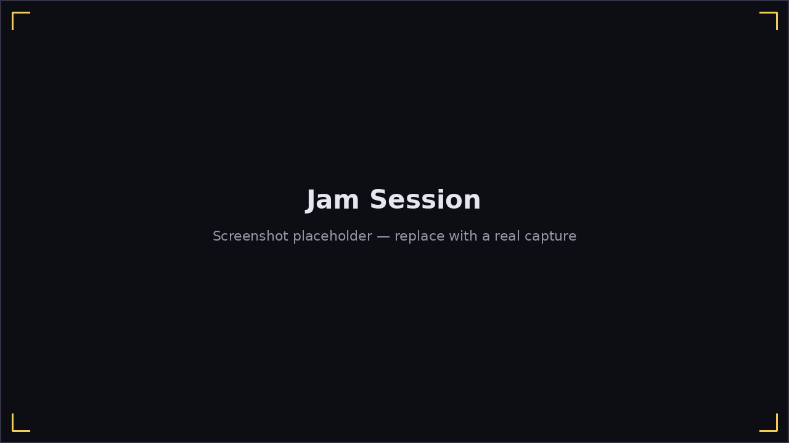

# Jam Session

**Play → Jam Session → Pick a Song** is free play: pick an artist and song
the same way as [Playing a Song](playing-a-song.md), but instead of scored
falling notes, you get an open 12-bar backing to improvise over, for as
long as the chosen backing and Loop setting allow. Nothing is scored.

You can jam on any instrument a song has a part for: the picker lists
each part separately — *Ode to Joy — chart* for the harmonica, *Ode to
Joy — guitar*, *Ode to Joy — flute* — and the screen draws the
instrument you picked.

By default the screen is a calm stage with one visual centre: the song
title (and, on a harmonica, which harp to grab), the **Loop** toggle
(restarts the backing track when it ends, instead of stopping), the
chorus/bar position, a big **current → next chord** readout, a compact
twelve-cell **form strip** that lights the bar you're in, and one line
naming **what the mic hears** — the hole and breath on a harmonica, the
note name (say *Note G4*) on any other instrument. It's gold for a chord
tone of the bar currently sounding, green for anywhere else in the
scale, amber for outside it. Follow the colour, not memorized theory.
That's everything you need to keep your eyes off the screen for a whole
chorus.

Click **Guides** to open the rest, remembered between jams:

- **Left**: the full **12-bar chord grid** (the current bar lights up as
  the backing plays), the **metronome**, and a live **spectrogram** of
  what your mic is hearing.
- **Right — your instrument**, with every note that fits the scale in
  green and the rest grey. The note you're playing lights up in the same
  colours as the indicator.
  - **Harmonica**: a reference bend diagram for every hole, plus the
    **hole map**, one cell per hole and breath.
  - **Guitar, bass, cavaquinho**: the **fretboard**, each string from
    open to the 12th fret, in your tuning.
  - **Piano**: a three-octave **keyboard**, C3 to C6.
  - **Flute, clarinet, violin, viola**: the instrument's **range** as a grid
    of notes, one octave per row with the highest on top.

There's no "wrong note" here in the scored sense — the map is a guide,
not a judge. It's the same live feedback the
[improvisation lesson](lessons.md#unit-2--counting-the-blues) uses, so
practicing here and in that lesson builds the same skill.

Want a backing track without picking an existing song? See
[Generate a Jam](jam-generate.md). Generated jams continue automatically and
replace the finite-song Loop control with **End after this chorus**.

Press **Esc**, or click the **⏸** button in the bottom-right corner, to
pause and reach the pause menu's Restart/Quit Session controls.

## Call & Response

On a harmonica part, turn on **⇄ Call & Response** and the game takes turns with you: every
four bars it plays a short harmonica phrase over the chords that are
sounding — two bars of "Listen…" — then steps back for two bars of
"Your turn". Answer however you like: echo it, vary it, or play
something else entirely. Nothing is compared or scored; the hole map
just shows the call's holes in a soft violet until the next one, as a
reminder of where it went, and lights whatever you play in the usual
colours.

The phrases are made for the harmonica you're holding, using only plain
blow and draw notes, so a call never asks for a bend you can't reach.
Each one has a little shape to it — a short motif, some space, an
answer that repeats or moves it up or down — and always lands on a
chord tone with a breath of air before your turn. The backing dips
slightly while the call speaks so it's easy to hear.

**Phrasing** cycles how busy the calls are: **sparse** (a few long
notes, lots of room), **conversational** (the default) or **busy**
(eighth-note runs). It's a mood, not a difficulty level — pick whichever
you'd rather trade phrases with.

## The band listens

In a generated jam the rhythm section pays a little attention to you. It
never judges a note — it only notices *how much* you're playing and when
you stop:

- After a busy four bars, the comping thins out for the next four so
  there's more room under you; play sparsely and it fills back in.
- Play a phrase and rest in the last bar of a four-bar stretch, and the
  band may answer — a short drum fill or a chord push into the next
  downbeat. It does this now and then, not every time.
- Stop playing altogether and it simply holds the groove; it won't rush
  to fill the gap.

Everything changes at bar lines and eases in, so a noisy mic can't make
the band twitch. **Adaptive band** turns it off if you'd rather the
backing play exactly as generated.

## MIDI backing with per-track muting

If the song you picked was authored from a MIDI file that kept its
original tracks (rather than one pre-mixed backing track), a row of
buttons appears below the 12-bar grid and the instrument, one per track,
each showing 🔊 next to the track's name. Click one to mute it — it
switches to 🔇 and drops out of the mix instantly, with no effect on the
other tracks or on timing; click it again to bring it back. This is handy
for stripping out a bass or rhythm track you'd rather play yourself, or
just hearing what one part of the arrangement sounds like on its own.
Mute state resets to "everything audible" each time you start the jam,
and — if Loop is on — carries over unchanged when the backing loops back
to the start.
