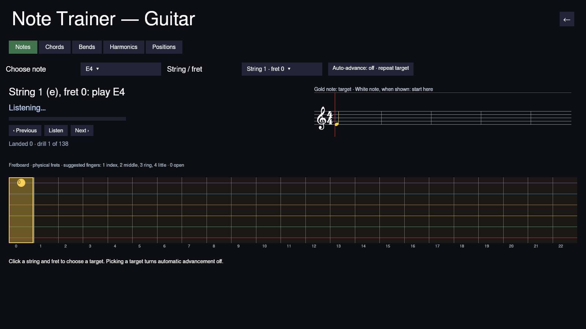
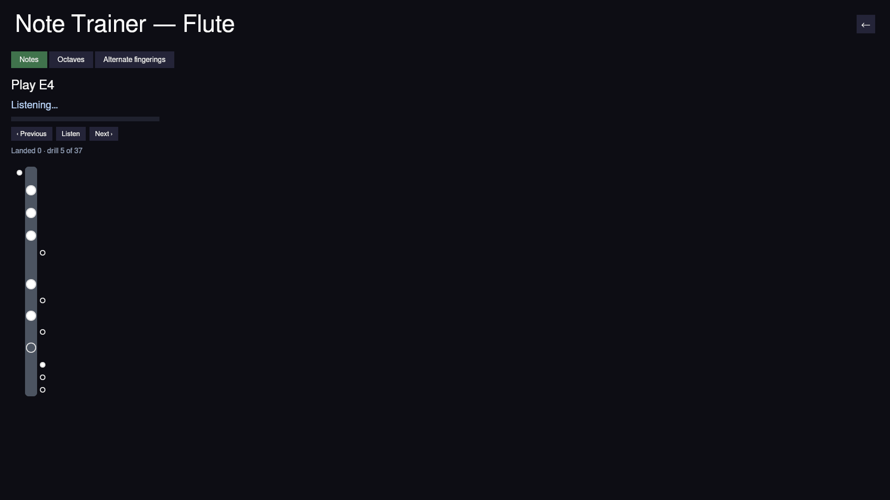

# Note Trainer

**Play → Note Trainer** asks which instrument you're practising.
**Harmonica** opens the [Bending Trainer](bending-trainer.md); **Guitar**,
**Flute**, and **Piano** open the Note Trainer described here. Like the Bending Trainer
it is practice, not a lesson: there is no song and nothing to fail.

The tabs across the top choose what to drill:

- **Notes**: a string and a fret; play that note and hold it.
- **Bends**: a fretted note to bend up a half step or a whole step. The
  status line follows the bend as it rises, so you can hear and see how far
  you have to go.
- **Harmonics**: touch the string lightly over the fret shown, without
  pressing it down, to sound its natural harmonic.
- **Positions**: a note and a string, but no fret. The same pitch exists
  elsewhere on the neck; the drill is finding it on this string.

The large line says what to play, and the line under it what the trainer
hears: the starting note, how far through a bend you are, how many cents
sharp or flat you sit, or which other note you played instead. Hold the
note in tune until the bar fills and the drill is **landed**; the next one
follows on its own. **‹ Previous** and **Next ›** move through the drills
yourself, and **Listen** plays the target on a plucked string.

Each tab keeps its own progress, for the guitar and the flute separately:
how many drills you've landed, and which drill you were on. Coming back,
even after closing the game, picks up there.

The full fretboard shows every physical fret, with string 1 at the top,
and marks the target on its string. A shaded region suggests the hand's
position. The target dot uses suggested finger numbers (0 for an open
string), matching the song-play guide. **Positions** hides the target fret
until **Show position** is pressed; the next drill hides it again.
How close counts as in tune, and how long to hold, come from the same
settings as the Bending Trainer's.

The trainer hears a pitch, not a string, so in Positions it trusts you to
play the note on the string it asks for.

## Flute

The flute's tabs are:

- **Notes**: every note from the lowest to C7; play it and hold it.
- **Octaves**: finger the lower note, then blow faster to jump to the
  note above on the very same keys, the way the flute's second octave
  sits on its first.
- **Alternate fingerings**: a high note on one particular fingering, the
  standard one or one of its alternates.

The horizontal flute below lights the keys of the fingering to use, with
the headjoint at the left. Filled keys are pressed; outlines stay open.
The staff shows the target in gold and, for octave drills, the starting
note in white.
**Listen** plays the note in the game's flute voice. As with the guitar,
the trainer hears the pitch, so it trusts you to use the fingering it
shows.

## Piano

The trainer shows all 88 keys from A0 to C8 at a stable width. Gold marks
the target and blue the detected note. The grand staff shows both clefs.
Labelled left- and right-hand rectangles suggest five-finger positions,
keeping a position until the target requires a move. These are suggestions,
not required hand assignments: pitch detection cannot tell which hand played.
The drills cover C3–C6. **Listen** uses the piano voice. On short screens,
scroll to reach the keyboard.
