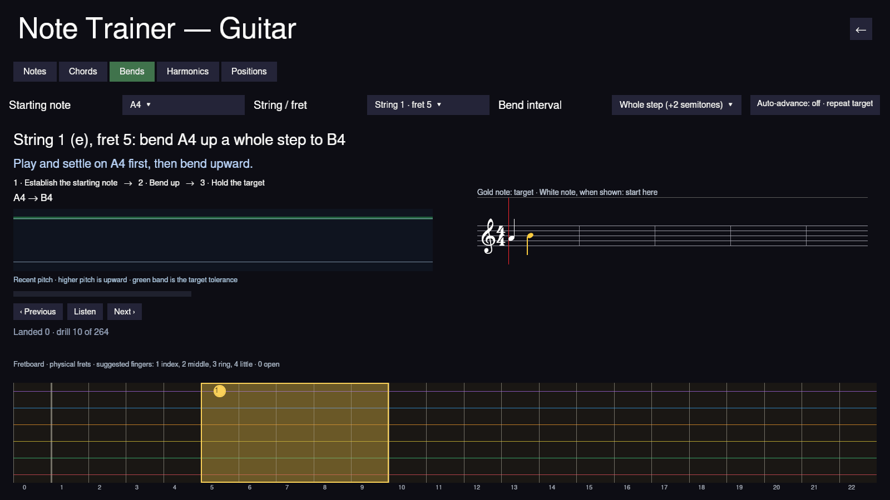
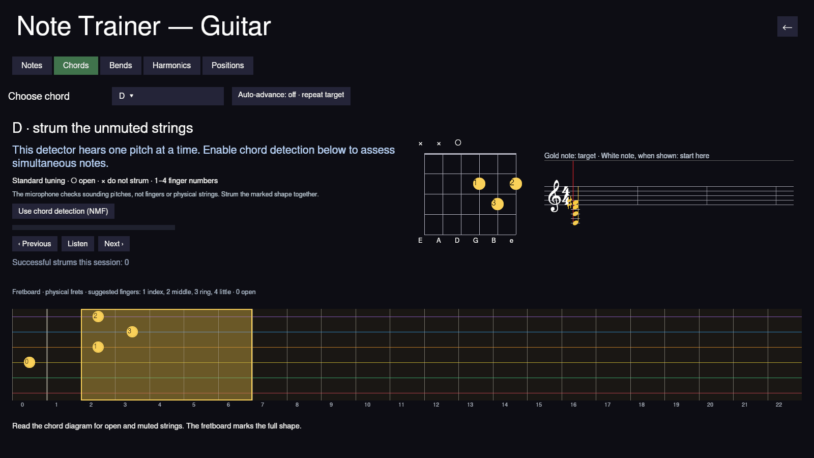

# Note Trainer

**Play → Note Trainer** asks which instrument you're practising.
**Harmonica** opens the [Bending Trainer](bending-trainer.md); **Guitar**,
**Bass**, **Flute**, and **Piano** open the Note Trainer described here. Like the Bending Trainer
it is practice, not a lesson: there is no song and nothing to fail.

The tabs across the top choose what to drill:

- **Notes**: a string and a fret; play that note and hold it.
- **Bends**: a fretted note to bend up a half step or a whole step. The
  status line follows the bend as it rises, so you can hear and see how far
  you have to go.
- **Harmonics**: touch the string lightly over the fret shown, without
  pressing it down, to sound its natural harmonic.
- **Positions**: a note and a string, but no fret. The same pitch exists
  elsewhere on the neck; the drill is finding it on this string.

The large line says what to play, and the line under it what the trainer
hears: the starting note, how far through a bend you are, how many cents
sharp or flat you sit, or which other note you played instead. Hold the
note in tune until the bar fills and the drill is **landed**; the next one
follows on its own. **‹ Previous** and **Next ›** move through the drills
yourself, and **Listen** plays the target on a plucked string.

Single-note exercise tabs keep their own saved progress, separately for
guitar, flute and piano: how many drills you've landed, and which drill
you were on. Coming back,
even after closing the game, picks up there.

The full fretboard shows every physical fret, with string 1 at the top,
and marks the target on its string. A shaded region suggests the hand's
position. The target dot uses suggested finger numbers (0 for an open
string), matching the song-play guide. **Positions** hides the target fret
until **Show position** is pressed; the next drill hides it again.
How close counts as in tune, and how long to hold, come from the same
settings as the Bending Trainer's.

The trainer hears a pitch, not a string, so in Positions it trusts you to
play the note on the string it asks for.

## Flute

Choose **Flute foot joint** above the exercise: **C foot** starts at C4,
while **B foot** includes B3. This is remembered in **My instruments** and
used the next time you open the trainer. Changing it updates both the
score and the fingering drawing, keeping your current note when possible.

The flute's tabs are:

- **Notes**: every note from the lowest to C7; play it and hold it.
- **Octaves**: finger the lower note, then blow faster to jump to the
  note above on the very same keys, the way the flute's second octave
  sits on its first.
- **Alternate fingerings**: a high note on one particular fingering, the
  standard one or one of its alternates.

The horizontal flute below lights the keys of the fingering to use, with
the headjoint at the left. Filled keys are pressed; outlines stay open.
Choose a note directly on the score: each note and its name form one
clickable target, also reachable with Tab and Enter. The score covers the
flute’s full range, including low B when using a B foot joint. Gold marks
the selected target; a white outline marks the starting note for an octave
drill. Dimmed notes are unavailable in the current exercise. Selecting a
note keeps it for repeated attempts; enable **Auto-advance** to work through
the sequence instead. Use Previous and Next to step through alternate
fingerings of the same pitch.
**Listen** plays the note in the game's flute voice. As with the guitar,
the trainer hears the pitch, so it trusts you to use the fingering it
shows.

## Piano

The trainer shows all 88 keys from A0 to C8 at a stable width. Gold marks
the target and blue the detected note. The grand staff shows both clefs.
Labelled left- and right-hand rectangles suggest five-finger positions,
keeping a position until the target requires a move. These are suggestions,
not required hand assignments: pitch detection cannot tell which hand played.
The drills cover C3–C6. **Listen** uses the piano voice. On short screens,
scroll to reach the keyboard.

## Choosing and repeating a guitar target

Use **Choose note** to pick a pitch, then **String / fret** to choose one
of its available positions. You can also click directly on a string and
fret. The controls follow the selected exercise tab, so harmonic positions
and bend targets stay playable. Choosing a target switches **Auto-advance**
off: practise it until you choose another. After a successful hold, release
the note before trying again. Turn Auto-advance on for the guided sequence.
The instructions and score sit together above the full-width fretboard.

In **Bends**, the note picker chooses the starting pitch. Choose its string
and fret, then the half- or whole-step interval. Establish the unbent note
briefly before bending; hitting the final pitch alone does not complete the
exercise. The live trace rises with pitch and shows a green target band.
Overshoot feedback asks you to relax the bend. Release between focused attempts.

## Guitar chords

In standard tuning, **Chords** offers Em, E, Am, A, D, Dm, C and G. Choose
a chord from the combobox. Its diagram marks open strings with ○, muted
strings with ×, and fretting fingers with 1–4; the full fretboard and staff
show the same shape and sounding pitches. **Listen** plays the whole chord.

Strum the unmuted strings together and hold until the bar fills. Feedback
names missing and unexpected pitches. Notes plucked one at a time cannot
accumulate into a completed chord. Stop the strings ringing between attempts.
The count reports successful strums this session, not mastery. Auto-advance
can cycle the chord list; leave it off to repeat one chord.

A polyphonic detector is required. If a monophonic detector is selected, the
trainer explains why it cannot assess the chord and offers **Use chord
detection (NMF)**. The microphone checks pitches, not which finger or physical
string produced them; use the diagram to check your hand and muted strings.

Guitar opens with Auto-advance off and preserves that choice across exercise
tabs. Reference playback temporarily pauses assessment so hearing the app's
own reference through the microphone cannot complete an attempt.

## Bass

Choose **Bass** for fretted electric bass. It shares the clickable fretboard
and pitch/position selectors with Guitar, with separate saved progress. The
tabs offer notes, natural harmonics and alternate string positions; guitar
chord shapes and guitar bend drills are not offered.

Markers show **fret numbers**, with 0 meaning an open string. They do not
prescribe a one-finger-per-fret stretch. Use a comfortable hand position and
shift as needed. The microphone checks sounding pitch, not the string or
finger used.

The score uses bass clef with an octave-below indication: the written notes
sit an octave above their sounding pitch. High-register targets use treble
clef with the same octave relationship to keep them readable. Note names and
audition audio use the sounding pitch. Standard four-, five- and six-string tunings and Drop D
are available under **Options → My instruments → Bass tuning**. This tuning
is saved separately from Guitar's and is used when opening the bass trainer.
Use a clean microphone or pickup input and mute unused strings.

## Cavaquinho

Cavaquinho shares the clickable fretboard, note selector and position exercises.
Its default setup is the **Brazilian traditional** tuning, with sounding pitches
D4–G4–B4–D5 from string 4 to string 1. The preset labels list string 1 first,
matching the editor and tablature. **Brazilian natural** and **Violin / mandolin**
are separate presets under **Options → My instruments → Cavaquinho tuning**.
These names describe particular traditions, not a universal cavaquinho tuning.
Other tunings can be authored per string in the Song Editor.

In Brazilian traditional tuning with no capo, **Chords** offers G, C, D and Em
shapes on four strings. The small chord diagram suggests finger numbers; the
large fretboard marks fret numbers. Shapes are offered only for the tuning they
were defined for. Chord assessment requires a polyphonic detector; the microphone
checks pitches, not the fingering, strumming gesture or number of physical strings.

The open-string frequencies follow [UFERSA's acoustics study, table 6](https://mnpef.ufersa.edu.br/wp-content/uploads/sites/94/2021/03/Disserta%C3%A7%C3%A3o-Final.pdf).
The named tuning variants follow [Musixe's teaching chart](https://static.musixe.com/wp-content/uploads/2021/05/15110318/Aula-1-Cavaquinho-Apresentacao-PDF.pdf).
