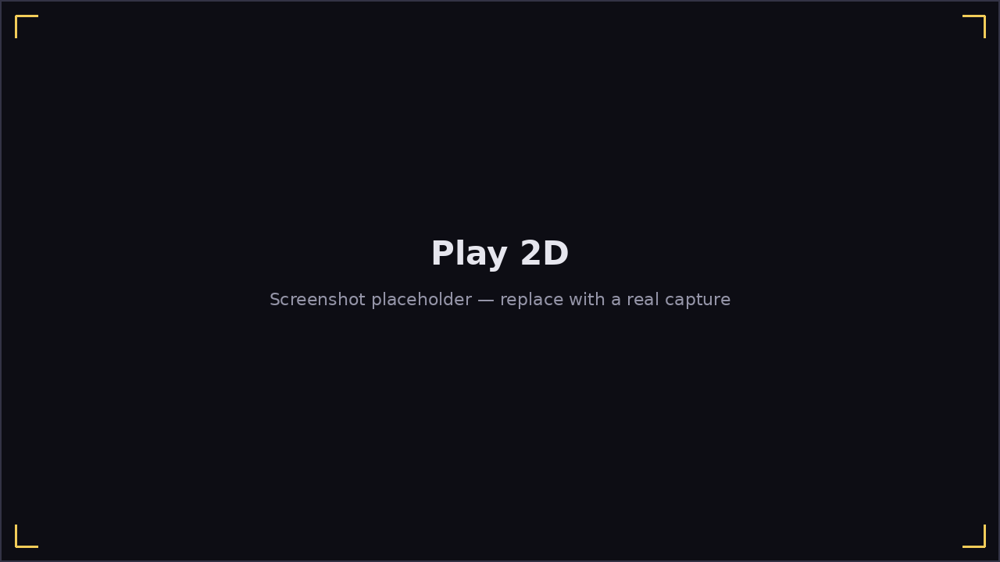

# Play 2D

The 2D mode shows notes as a **falling note highway**: ten lanes (one per
harmonica hole), each note a colored ribbon as long as the note lasts,
scrolling down toward a fixed hit line. The bright cap at a ribbon's
bottom is the attack, and holds the note's tab (`-4`, `-3''` for a bend).

- Notes are colored by **breath direction** — blow and draw each get their
  own color, shown in the legend beside the highway.
- A note turns gold while you hold it, and red if it's missed. Techniques
  are drawn along the ribbon — see [Playing a Song](playing-a-song.md).
- The **hole strip** along the bottom mirrors your harmonica, live —
  useful for double-checking which hole/direction a note actually wants
  without reading the lane position.
- Optional **hole-number labels** (Options → Note labels) replace the
  plain up/down arrow in each note's cap with its actual hole number, if you'd
  rather read "4" than work out the arrow from the lane.
- The **metronome**, **technique legend**, and **score/combo** sit in the HUD
  to the side of the highway. Authored phrase and chord labels appear in the
  phrase banner; gameplay does not invent a blues progression for a chart that
  does not contain one.
- A **tab-notation ribbon** shows the current musical phrase's notes as
  plain text (e.g. `-4' +5 -4`) as they come up — handy if you're more
  comfortable reading harmonica tab than the highway.

For scoring, pausing, looping and adaptive difficulty, see [Playing a
Song](playing-a-song.md).
