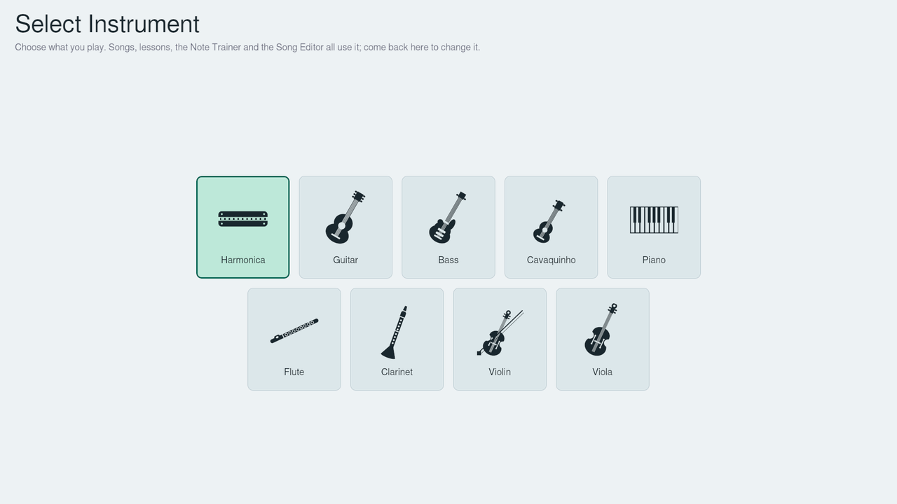

# Select Instrument

Harmonicon opens on **Select Instrument**: a grid of every instrument it
teaches, each with its picture and name. Click one, or move to it with
**Tab** and press **Enter**, and the main menu opens.

That one choice is used everywhere:

- **Play Song** and **Jam Session** list only that instrument's songs.
- **Note Trainer** opens straight on it — the
  [Bending Trainer](bending-trainer.md) for a harmonica, the
  [Note Trainer](note-trainer.md) for anything else.
- **Lessons** loads only its curriculum.
- **Create Song** starts a document for it.
- **Tuner** tunes it. A guitar, bass or cavaquinho starts on its saved
  tuning and capo; a violin or viola on its standard fifths (E A D G and
  A D G C). Only those five have a tuner, so the Play menu shows the
  button for them alone.

The game remembers your choice, so on the next launch that card is already
highlighted and focused: press **Enter** to carry on with it.

To change instrument, go back to this screen: the main menu's first button,
**Instrument: …**, names the current one and opens the grid. **Back** (or
**Esc**) returns to the main menu without changing it. Nothing else in the
game switches instrument.

The setup of each instrument — a guitar's tuning and capo, a flute's foot
joint — is still in [Options → My instruments](options.md#my-instruments).
